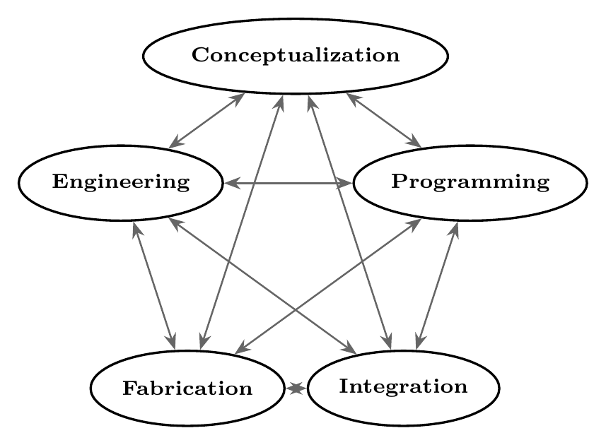
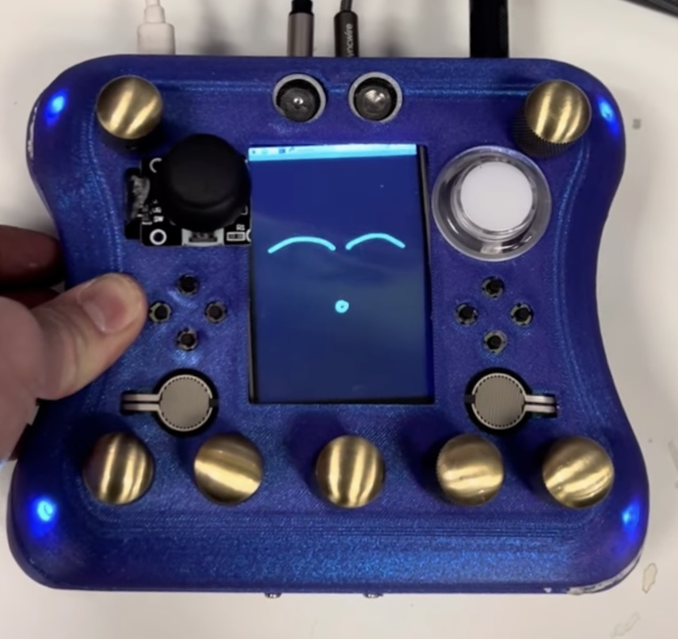
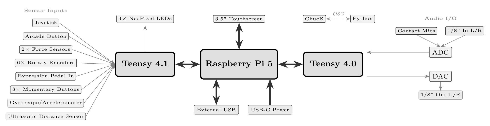
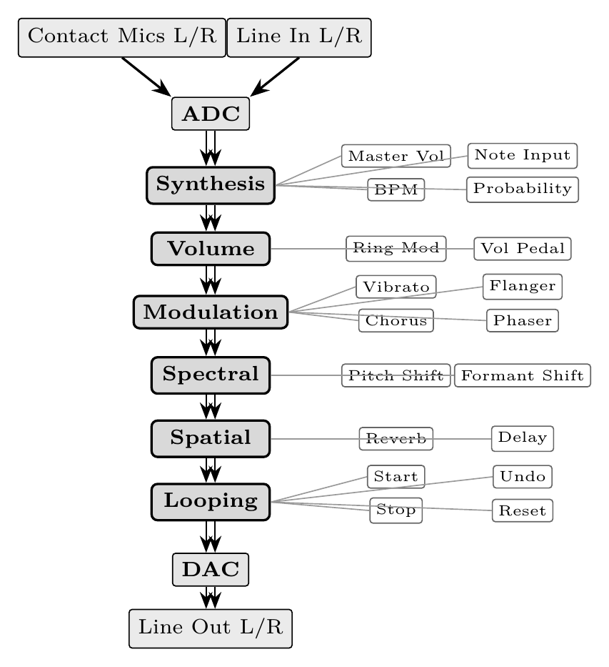
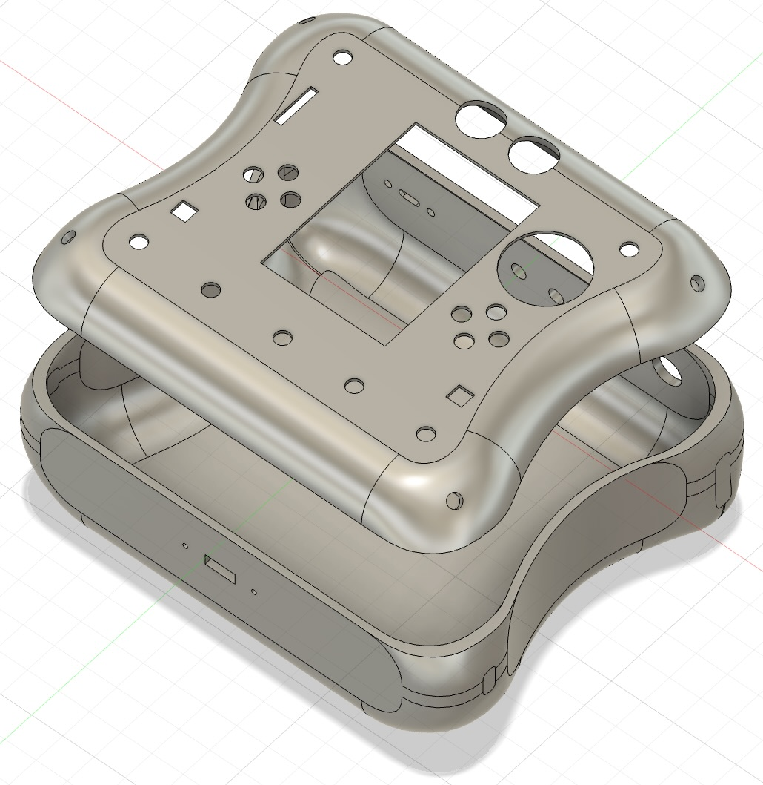
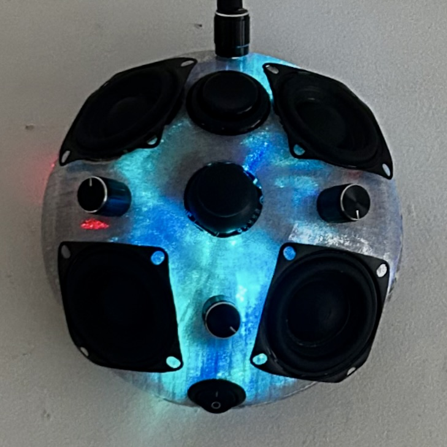
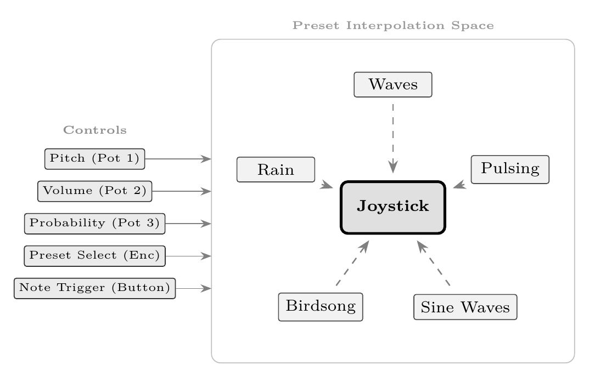
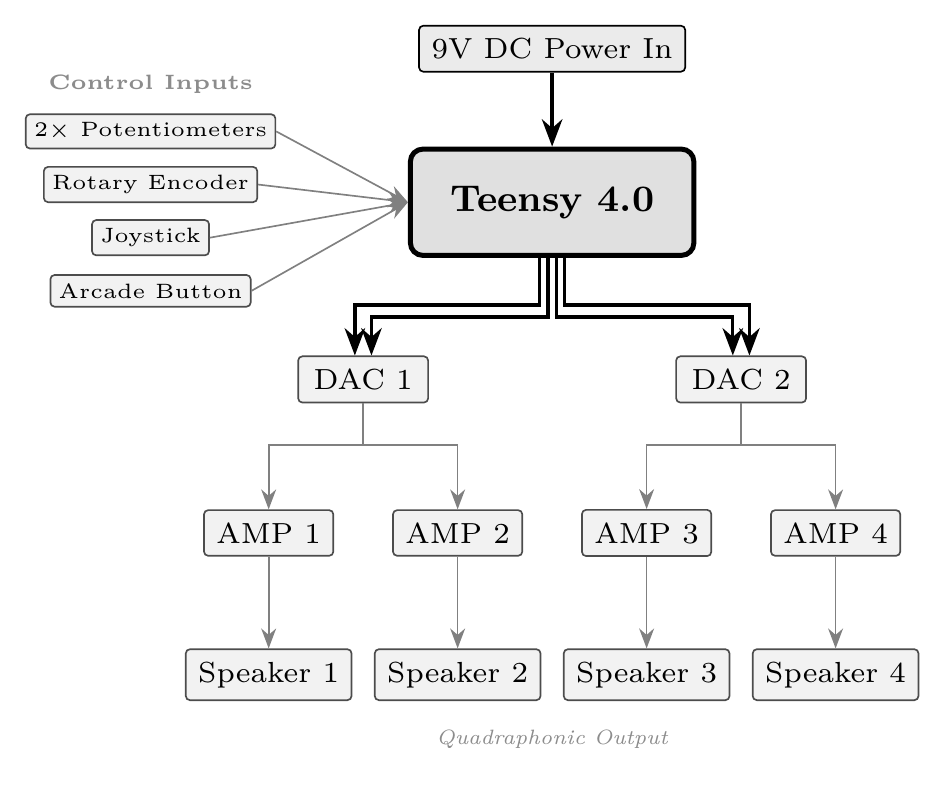
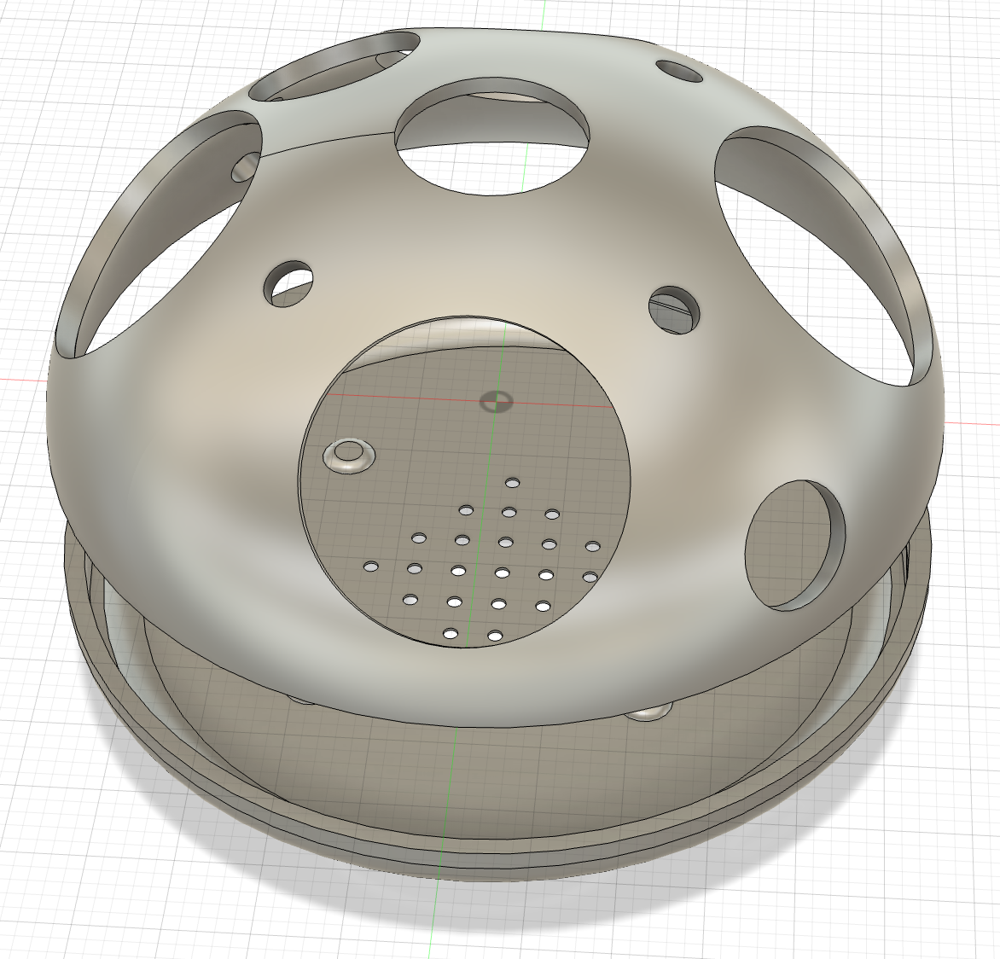

# Workflow of a Modern Digital Luthier: Unifying Embedded Audio and Graphics Computing, Digital Fabrication, and Purposeful Interaction Design

*Submitted as a Process Report to ROTURA — Revista de Comunicação, Cultura e Artes. Special Dossier: Advances in Digital and Interactive Arts — Cultures, Communities and Territories of Media Art. Author information removed for double-blind review.*

---

## Abstract

The parallel maturation of single-board computers, microcontrollers, audio-visual programming languages, fabrication techniques, and access to information has created an environment where form emerges as a coherent system rather than in sequential layers. This convergence enables individuals to rapidly develop self-contained interfaces where gesture, sound, graphics, and physical structure are implemented as direct extensions of artistic intention. This paper presents two case studies demonstrating this methodology: NEPTR, a handheld performance instrument with dense sensor input and synchronized audiovisual feedback along with BOUBA, a quadraphonic tactile sound object designed for therapeutic ambient synthesis. Both prototypes were completed in a combined timeline of under four months at a combined cost of under \$300 USD, without institutional resources or commercial software. They are presented not as finished or high-quality instruments but as evidence of what someone can accomplish with this workflow. This paper also documents the pitfalls of this approach: neither instrument has a user base beyond its builder, both are vulnerable to the demo problem that keeps new interfaces from being adopted, and the accessibility this workflow offers is real relative to what it replaced while still assuming an investment of time, technical familiarity, design skill and the ability to use at least one programming language. These examples illustrate how story-driven design across integrated domains produces coherent interactive identity and indicate where this practice is heading as these tools continue to mature.

**Keywords:** digital lutherie; rapid prototyping; embedded audiovisual computing; story-driven design

---

## 1. Introduction

A threshold has been crossed in interactive system design, beyond the predictable increase of Moore's Law. The convergence of embedded computing, new programming environments, accessible fabrication, and open educational resources has lowered barriers to such an extent that a qualitatively different approach to digital lutherie is emerging. One where individuals can rapidly prototype and complete self-sufficient instruments within an integrated workflow, as shown in Figure 1.

Ten years ago, building a self-contained digital instrument required significant resources or compromise. Sensor-rich controllers depended on external computers and self-contained devices sacrificed computational headroom or interface density. The crossing of this threshold is causing the gap between commercial-quality and independent projects to collapse. The following sections map this ecosystem, followed by two case studies demonstrating this workflow's effectiveness and a reflection.

This report is practice-based research, the evidence being these instruments' relationships to their luthier. The claims made here come directly from this process. This position trades objectivity for access to the decisions themselves, including the ones that were made badly and require revision.

---

## 2. Approach

This section is not focused on documenting exponential progress, but demonstrating how individual practices now function as parts of an integrated workflow, rather than separate domains requiring separate approaches. The subsections below map this ecosystem and the constraints that give it coherence.

{width=55%}

### 2.1 Design Context

The design principles established by the NIME and ICMC communities have not been outpaced by this convergence, they become more urgent because of it. Fels' demonstration that intimacy emerges from mapping quality rather than parameter quantity becomes a discipline given how trivially extensive controls can be implemented (Fels, 2004). Hunt and Wanderley's finding that expressivity lives in gesture-sound relationships rather than either element's sophistication informs modern builders of the need to constrain their palettes deliberately (Hunt & Wanderley, 2002). Jordà's tension between flexibility and identity shows the need for deliberate decision making in what to omit from a modern interface (Jordà, 2004). Cook's advocation that "some instruments are meant to be stupid" (Cook, 2001), Zappi and McPherson's demonstration that constrained instruments can produce richer performer engagement (Zappi & McPherson, 2014) and Morreale and McPherson's study finding that design coherence can predict whether performers continue engaging with new interfaces over time (Morreale & McPherson, 2017) function as active design constraints, distinguishing coherent instruments in an era where adding unnecessary complexity is so accessible.

### 2.2 Platform Ecosystem

Single-board computers efficiently handle complex graphics, high-level languages and autonomous tasks, made even more efficient with specialized Linux distributions like Satellite CCRMA (Berdahl & Ju, 2011). Microcontrollers like Teensy (PJRC, 2021) handle local synthesis, DSP, and dense sensor/audio I/O with USB class-compliance while platforms like Bela (Moro et al., 2016) achieve sub-millisecond latency for tight tactile coupling. These platforms' ability to operate independently or interconnectedly based on an instrument's requirements represents a modularity where needs dictate architecture. A Teensy can manage time-critical analog sensing while a Pi runs computationally intensive tasks, or a custom PCB can link together the exact components an instrument needs. Organizations like the Arduino foundation (Banzi & Shiloh, 2015) open-sourcing their work has made the designing of a purpose-built microcontroller an accessible task. Platform selection serves interaction requirements in cost effective ways, helping a digital luthier easily meet the needs of their system.

### 2.3 Audio and Graphics Computing

Integrated programs managing audio and graphics behavior means an instrument designer can approach audiovisual behavior as a single problem rather than coordinating between separate systems. An SBC can easily communicate between a network, microcontroller, and multiple languages so interaction with audio and video output can be approached as one multi-faceted interface. Tools like ChuGL (Atherton et al., 2024) point toward even tighter integration, unifying lower-level audio and visual programming in approachable environments.

### 2.4 Programming Environments

Languages like Csound (Boulanger, 2000) and ChucK (Wang et al., 2015) run at high efficiency across laptops and SBCs, while the Teensy Audio Library brings complex synthesis and DSP to the microcontrollers, and RNBO (Cycling '74, 2023) offers a compelling prototyping process for exporting pseudo-code across web, hardware, plugin, and standalone applications. WebChucK (Atherton & Wang, 2023) extends the power ChuGL to browsers via WebAssembly while Strudel (Roos & McLean, 2023) brings Tidal Cycles' live coding to the browser with no installation, demonstrating what Roberts and Wakefield identified as the web browser's maturation into legitimate musical interface (Roberts & Wakefield, 2018). This variety of cross-platform options demonstrates the dissolving of boundaries between development environments and deployment targets while allowing developers to use programming environments flexibly to meet specific needs.

### 2.5 Sensing and Output

Modern microcontrollers can manage any open-source sensor through library abstractions. I2C, SPI, and serial protocols can distribute sensor data across an instrument while USB presents custom hardware as class-compliant audio devices, MIDI controllers, or serial ports, enabling communication between devices. Wanderley and Depalle's taxonomy of gestural control strategies (Wanderley & Depalle, 2004) remains an essential contribution in this space, implying that control curation is more consequential than ever when the cost of capturing so much becomes so little.

### 2.6 Digital Fabrication

Cook's advocacy for co-designing systems (Cook, 2004) best represents why physical form should be developed in sync with the rest of the lutherie process. Modern fabrication tools allow for enclosures to be thoughtfully designed around specific needs, empowering physical form to be more of a design variable and less of a constraint. With reliable 3D printers like the Bambu Lab A1 mini costing less than \$250 USD (Bambu Lab, 2024), and software like Blender (Blender Online Community, 2024) making professional-grade 3D modeling free to the public, electronics layout and physical form can develop simultaneously throughout the prototyping process. Enclosure is shifting away from housing and further towards interface from the first stages of design, which points towards what Magnusson describes as the screenless turn: physical form carrying semantic weight that has been unnecessarily delegated to the screen (Magnusson, 2019). Çamcı and Granzow presented a system at ICMC 2025 that offers another dimension to this iteration, testing variables like geometry, interaction mapping, and sound design in VR before committing to fabrication (Çamcı & Granzow, 2025). By allowing designers to experiment in VR with virtual prototypes that directly translate to physical manufacturing pipelines, they demonstrate that the traditional sequence of fabrication is collapsing into an iterative loop that can start or end at any stage.

### 2.7 Access to Information

Free courses, conference proceedings, effective documentation and tutorial ecosystems have made the broad sub-disciplines of digital lutherie accessible without financial investment. While AI's place in this context will continue to be debated in more appropriate settings, LLMs are already capable of hugely compressing the time between a digital luthier encountering a broad range of problems and achieving a working solution. The bottleneck of a builder's vision exceeding their access to information has been largely eliminated.

---

## 3. Case Study: NEPTR

{width=62%}

NEPTR is a handheld performance instrument for synthesis, effects processing and looping, supporting handheld and floor-based interaction.

### 3.1 Purpose

The vision behind NEPTR is to access a modern level of compute and high density of sensor input without the distraction or unnecessary elements of a laptop. It provides two distinct modes of interaction: handheld and foot-controlled mode. The OP-1 (Teenage Engineering, 2012) achieves much of the desired multi-faceted independence but is limited in sensor input, programmability and affordability. Monome's Norns (Monome, 2018) provide extensive programmability and a powerful computer but require a network of external controllers and sensors to unlock notable interactive potential. This follows a pattern in mainstream hardware performance, to assemble expensive ecosystems of gear, cables and power supplies which create unnecessary complexity and barrier to entry. NEPTR is a response to this: an open-source, programmable interface for musical expression independent of the laptop.

### 3.2 Programming

On boot, a Pi 5 launches Python and ChucK with optimized priority. ChucK handles synthesis and effects processing while Python manages the GUI, communicating over OSC. ChucK's "machine" mechanism loads synthesis and effects dynamically, utilizing multi-threading while a layered menu system maps controls to parameters.

NEPTR combines acoustic input with onboard generative synthesis and modularly routes these inputs through an expanding repository of ChucK DSP files (see Figure 4). The top encoder-buttons navigate between menus while the bottom encoder-buttons toggle effects depending on which menu the user is in while all encoders' rotation adjusts a variety of parameters depending on the menu context.

Four NeoPixel LEDs provide stage-visible feedback with brightness reflecting expression pedal state and color confirming encoder presses, following the type of visual feedback present in guitar-pedals. After enough time without input, NEPTR gets "bored" and starts "making faces" until it receives more controller input, which personifies the instrument further.

{width=100%}

{width=68%}

### 3.3 Hardware

NEPTR runs on a Raspberry Pi 5 with a Teensy 4.0 managing audio I/O and a Teensy 4.1 managing controls as shown in Figure 3. The stereo line-in is normalled to the two contact microphones mounted to NEPTR's inner sides, creating an inescapable acoustic relationship to the instrument. NEPTR then provides the user with an external USB port, a stereo 1/8th inch input, a stereo 1/8th inch output, an expression pedal input and a USB-C power input.

### 3.4 Fabrication

{width=68%}

The 3D-printed enclosure, as seen Figure 5, was designed to integrate a variety of sensors while enabling the use of two distinct modes of interaction: handheld, game-controller ergonomics with rounded grips and controls positioned for thumb and finger access or foot-controlled, pedalboard style interaction which places the device flat on a floor and allows for comfortable control of encoder buttons, joystick, ultrasonic sensor and an external expression pedal if the user cannot interface with their hands. The layout was developed through integrated approach with iterative 3D modeling and print revision at a material cost of <\$30 USD.

### 3.5 Evaluation

Evaluating against O'Modhrain's framework (O'Modhrain, 2011): *Playability* is notably high. The instrument responds well to gestural intent and the mapping of sensors to parameters has been refined through iterative practice to feel natural. *Learnability* is low with NEPTR's current programming, but the ease of reprogramming allows for this to be easily improved upon based on the needs of a given user. *Sonic range* is wide, given the variety of effects and modes of synthesis. *Robustness* has been tested and seen issues with audio I/O, suggesting the need to use PCBs over dead-bug style connections beyond the prototyping stage.

---

## 4. Case Study: BOUBA

{width=62%}

BOUBA is a quadraphonic sound object providing tactile interaction with therapeutic generative synthesis.

### 4.1 Purpose

BOUBA serves the non-musician seeking a psychologically beneficial relationship with sound. It is a research-based tool for improving four pillars of human experience: sleep, mood, productivity and autonomic regulation. It cost \$80 USD to reproduce, and its physical controls along with its spatialization foster an intimate and unique relationship with the user.

### 4.2 Programming

BOUBA is programmed with the Teensy Audio Library (PJRC, 2021), centered around a number of generative compositions that are self-sufficient but interactive (see Figure 7).

{width=78%}

### 4.3 Hardware

BOUBA runs with no external connections besides power (see Figure 8). Onboard controls select or interpolate between presets, manually trigger notes, and adjust volume, probability or pitch. Four speakers deliver quadraphonic output from two PCM5102 DACs amplified by four LM386 amplifiers. The system is powered from a standard 9v jack which is stepped down for different components, allowing for use with common cables or batteries.

{width=62%}

### 4.4 Research Baseline

For *sleep enhancement,* Farokhnezhad Afshar et al. demonstrated significant improvements in coronary care patients exposed to white noise (p=0.01) (Farokhnezhad Afshar et al., 2016), while Gao et al. reported a 38% reduction in sleep latency (p<0.01) and increased delta power using sine-based music in insomniacs (Gao et al., 2020). These inform BOUBA's adjustably filtered noise layers and generative sine waves.

For *mood regulation,* Benfield et al. found natural soundscapes boosted positive affect by 0.8 points post-stressor (p<0.01) (Benfield et al., 2014), and Blood et al.'s PET data showed consonant harmonic relationships engage paralimbic reward centers (F=42.49, p<0.001) while dissonant stimuli activate amygdala regions tied to negative valence (Blood et al., 1999). These findings inform BOUBA's nature-sound presets and restriction of harmonic content to consonant intervals.

For *productivity,* Awada et al. found 45 dB white noise increased attention and creativity by 12% (p<0.01) via stochastic resonance (Awada et al., 2022), while Karageorghis et al. showed rhythmic entrainment at 120–140 BPM improves endurance and work output (Karageorghis et al., 2011). These inform BOUBA's noise synthesis and steady rhythmic patterns.

For *nervous system regulation,* Khalfa et al. found salivary cortisol halved (p<0.05) post-stressor with ambient music (Khalfa et al., 2003), and De Witte et al.'s meta-analysis demonstrated significant physiological stress reduction (d=0.380) including lowered blood pressure and cortisol across music intervention conditions (De Witte et al., 2019). These inform BOUBA's priority of ambient consonance and musicality.

BOUBA does not attempt to replicate the clinical conditions of any cited study, but the relationship between these empirical findings and BOUBA's synthesis parameters is one of informed design and further validates its conceptual choices.

### 4.5 Fabrication

{width=68%}

BOUBA's enclosure positions speakers for quadraphonic imaging while centralizing controls for single-handed operation. The form factor prioritizes stability and simplicity, helping it sit naturally in a variety of situations.

### 4.6 Evaluation

Evaluating against O'Modhrain's framework (O'Modhrain, 2011): *Playability* is lower due to BOUBA's deliberately minimal control surface but the overall usability is effective for its purposes. *Learnability* is high due to the low number of controls and the self-sufficient nature of each preset, requiring little instruction to achieve satisfying results. *Sonic range* is intentionally constrained to consonant, ambient territory informed by the cited research, though the variety of generative compositions and parameter ranges provide a meaningful variety. *Robustness* has been high over two months of consistent use.

---

## 5. Conclusions

NEPTR and BOUBA are not presented as finished or high-quality instruments, they stand as evidence of the success that an inexperienced practitioner has found in this type of integrated workflow. Both prototypes were completed in a combined timeline of under four months at a combined cost of under \$300 USD without institutional resources or commercial software. They are proof that the emerging ecosystem and workflow described in Section 2 have transformed the context in which digital luthiers learn and work.

Several tensions remain with instruments like this. Morreale and McPherson's "demo problem" shows why these could resist integration with new users (Morreale & McPherson, 2017). The accessibility argument has serious limits, in that "free" software often requires hardware investment. This workflow assumes investment of time in technical familiarity, design skill, and the ability to use at least one programming language. But when the need is present, one can learn these skills efficiently without formal instruction while the tools can be acquired at relatively low cost.

As these tools reach optimal efficiency and begin competing across more axes, this practice will continue pushing further into a world where interfaces can be synchronically and nonlinearly realized. The effects of this transition will continue changing the face of technological interaction through a globally rising density of immersive experience. Leaving more powerful tools and deeply outlined frameworks in the hands of the next generations of digital luthiers.

---

## Acknowledgments

*[Withheld for double-blind review; to be restored in the final version.]*

---

## Bibliographic references

::: {custom-style="ReferenceEntry"}

[1] Atherton, J., He, G., & Wang, G. (2024). ChuGL: A strongly-timed audiovisual programming language. *Proceedings of the International Conference on New Interfaces for Musical Expression*.

[2] Atherton, J., & Wang, G. (2023). WebChucK: Bringing ChucK to the web. *Proceedings of the International Computer Music Conference*.

[3] Awada, M., Becerik-Gerber, B., Lucas, G., & Roll, S. (2022). Cognitive performance, creativity and stress levels of neurotypical young adults under diverse white noise levels: An experimental study. *Scientific Reports*, *12*, 17058. https://doi.org/10.1038/s41598-022-20063-4

[4] Bambu Lab. (2024). *A1 mini*. https://bambulab.com/en/a1-mini

[5] Banzi, M., & Shiloh, M. (2015). *Getting started with Arduino: The open source electronics prototyping platform* (3rd ed.). Maker Media.

[6] Benfield, J. A., Taff, B. D., Newman, P., & Smyth, J. (2014). Natural sound facilitates mood recovery. *Ecopsychology*, *6*(3), 183–188. https://doi.org/10.1089/eco.2014.0028

[7] Berdahl, E., & Ju, W. (2011). Satellite CCRMA: A musical interaction and sound synthesis platform. *Proceedings of the International Conference on New Interfaces for Musical Expression*.

[8] Blender Online Community. (2024). *Blender*. https://www.blender.org

[9] Blood, A. J., Zatorre, R. J., Bermudez, P., & Evans, A. C. (1999). Emotional responses to pleasant and unpleasant music correlate with activity in paralimbic brain regions. *Nature Neuroscience*, *2*(4), 382–387. https://doi.org/10.1038/7299

[10] Boulanger, R. (Ed.). (2000). *The Csound book: Perspectives in software synthesis, sound design, signal processing, and programming*. MIT Press.

[11] Çamcı, A., & Granzow, J. (2025). Virtual reality as a design tool for digital musical instruments. *Proceedings of the International Computer Music Conference*.

[12] Cook, P. (2001). Principles for designing computer music controllers. *Proceedings of the International Conference on New Interfaces for Musical Expression*, 3–6.

[13] Cook, P. R. (2004). Remutualizing the musical instrument: Co-design of synthesis algorithms and controllers. *Journal of New Music Research*, *33*(3), 315–320. https://doi.org/10.1080/0929821042000317877

[14] Cycling '74. (2023). *RNBO*. https://cycling74.com/products/rnbo

[15] De Witte, M., Spruit, A., van Hooren, S., Moens, E., & Stams, G.-J. (2019). Effects of music interventions on stress-related outcomes: A systematic review and two meta-analyses. *Health Psychology Review*, *14*(2), 294–324. https://doi.org/10.1080/17437199.2019.1627897

[16] Farokhnezhad Afshar, P., Bahramnezhad, F., Asgari, P., & Shiri, M. (2016). Effect of white noise on sleep in patients admitted to a coronary care unit. *Journal of Caring Sciences*, *5*(2), 103–109. https://doi.org/10.15171/jcs.2016.011

[17] Fels, S. (2004). Designing for intimacy: Creating new interfaces for musical expression. *Proceedings of the IEEE*, *92*(4), 672–685. https://doi.org/10.1109/JPROC.2004.825887

[18] Gao, D., Long, S., Yang, H., Cheng, Y., Guo, S., Yu, Y., Zhao, T., Li, W., & Pei, G. (2020). SWS brain-wave music may improve the quality of sleep: An EEG study. *Frontiers in Neuroscience*, *14*, 67. https://doi.org/10.3389/fnins.2020.00067

[19] Hunt, A., & Wanderley, M. M. (2002). Mapping performer parameters to synthesis engines. *Organised Sound*, *7*(2), 97–108. https://doi.org/10.1017/S1355771802002030

[20] Jordà, S. (2004). Instruments and players: Some thoughts on digital lutherie. *Journal of New Music Research*, *33*(3), 321–341. https://doi.org/10.1080/0929821042000317886

[21] Karageorghis, C. I., Jones, L., Priest, D. L., Akers, R. I., Clarke, A., Perry, J. M., Reddick, B. A., Lane, A. M., & Lim, H. B. T. (2011). Revisiting the exercise heart rate–music tempo preference relationship. *Research Quarterly for Exercise and Sport*, *82*(2), 274–284. https://doi.org/10.1080/02701367.2011.10599755

[22] Khalfa, S., Bella, S. D., Roy, M., Peretz, I., & Lupien, S. J. (2003). Effects of relaxing music on salivary cortisol level after psychological stress. *Annals of the New York Academy of Sciences*, *999*(1), 374–376. https://doi.org/10.1196/annals.1284.045

[23] Magnusson, T. (2019). *Sonic writing: Technologies of material, symbolic, and signal inscriptions*. Bloomsbury Academic.

[24] Monome. (2018). *Norns*. https://monome.org/docs/norns/

[25] Moro, G., Bin, A., Jack, R., Bernardo, F., & McPherson, A. (2016). Making high-performance embedded instruments with Bela and Pure Data. *Proceedings of the International Conference on Live Interfaces*.

[26] Morreale, F., & McPherson, A. (2017). Design for longevity: Ongoing use of instruments from NIME 2010–14. *Proceedings of the International Conference on New Interfaces for Musical Expression*.

[27] O'Modhrain, S. (2011). A framework for the evaluation of digital musical instruments. *Computer Music Journal*, *35*(1), 28–42. https://doi.org/10.1162/COMJ_a_00038

[28] PJRC. (2021). *Teensy audio library*. https://www.pjrc.com/teensy/td_libs_Audio.html

[29] Roberts, C., & Wakefield, G. (2018). Tensions and techniques in live coding performance. In R. T. Dean & A. McLean (Eds.), *The Oxford handbook of algorithmic music*. Oxford University Press.

[30] Roos, F., & McLean, A. (2023). Strudel: Live coding patterns on the web. *Proceedings of the International Conference on New Interfaces for Musical Expression*.

[31] Teenage Engineering. (2012). *OP-1*. https://teenage.engineering/products/op-1

[32] Wanderley, M. M., & Depalle, P. (2004). Gestural control of sound synthesis. *Proceedings of the IEEE*, *92*(4), 632–644. https://doi.org/10.1109/JPROC.2004.825882

[33] Wang, G., Cook, P. R., & Salazar, S. (2015). ChucK: A strongly timed computer music language. *Computer Music Journal*, *39*(4), 10–29. https://doi.org/10.1162/COMJ_a_00324

[34] Zappi, V., & McPherson, A. (2014). Design and use of a hackable digital instrument. *Proceedings of the International Conference on Live Interfaces*.

:::
